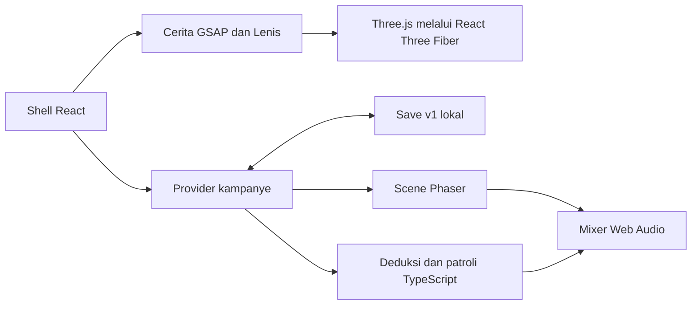

# Desain teknis dan urutan migrasi

## Kepemilikan state

React memegang shell, dialog, pengaturan, jurnal dan navigasi. Satu provider kampanye menentukan malam aktif, latihan, hasil dan preferensi. Engine hanya menerima opsi bertipe dan mengirim peristiwa. Data simulasi per frame tetap berada di engine. Renderer cerita mengikuti progress scroll, terpisah dari progres tujuh malam.

## Kontrak dan siklus hidup

- Setiap mode mengekspor `start(host, options)`. Handle menyediakan pause, resume, destroy dan updatePreferences. Hasil kemenangan berisi koin, delta nyala dan petunjuk opsional. Peristiwa ancaman terpisah dari kemenangan.
- Pembukaan engine asinkron memiliki pembatalan saat unmount/pindah layar. Satu percobaan dapat menyelesaikan tepat satu hasil. Jeda menyimpan simulasi di tempat. Mulai ulang membuat instance baru.
- Key `indoghost.preferences.v1` dan `indoghost.night.v1.1` s.d. `.7` tetap menjadi basis kompatibilitas. Tulisan baru mengikuti bentuk v1. Penyimpanan yang ditolak memakai state sesi. Rekaman tidak valid dipulihkan sampai awalan terakhir yang utuh.
- Dialek visual memanfaatkan terang lampion, hitam kehijauan, tipografi Cormorant Garamond dan ilustrasi desa. Narasi, kontrol utama dan akses skip menggunakan DOM dan tetap dapat dipakai selama renderer dekoratif sedang dimuat.
- Render 3D dan engine permainan dipisahkan melalui dynamic import. Batasi DPR dan partikel. Bersihkan tekstur, timeline, listener, audio dan scene saat berhenti. Status ancaman memiliki padanan visual saat suara dimatikan.

## Strategi verifikasi

Bandingkan level, jumlah koin dan jalur petunjuk dengan tabel audit. Uji aturan tanpa renderer, lalu uji browser memakai input pemain dan save baru maupun v1. Uji scroll dua arah, navigasi eksplisit, respons pointer, perubahan lighting, GPU gagal, reduced motion, modal dan restart. Gunakan build produksi serta catat ukuran transfer dan kondisi pengukuran. Hasil simulasi layar ponsel dan hasil playtest manusia didokumentasikan terpisah.

Rujukan implementasi berupa [Phaser](https://docs.phaser.io/), [ScrollTrigger](https://gsap.com/docs/v3/Plugins/ScrollTrigger/), [Lenis](https://github.com/darkroomengineering/lenis), [React Three Fiber](https://r3f.docs.pmnd.rs/getting-started/introduction) dan [Vite](https://vite.dev/guide/).
