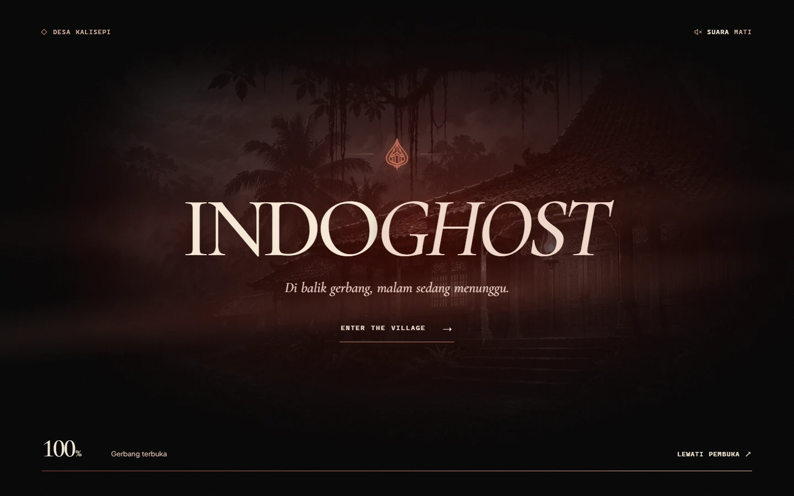

# Gerbang pembuka Desa Kalisepi

Pada awal sesi tab, logo IndoGhost muncul di atas gerbang joglo Kalisepi. Kabut bergerak melintasi lampion, sementara angka di bawah layar menunjukkan berapa banyak aset penting yang sudah bisa ditampilkan. Pemain bisa memilih suara dan menekan **ENTER THE VILLAGE** atau langsung memakai **Lewati pembuka**. Setelah masuk, reload, tautan bagian, jurnal dan permainan bisa diakses tanpa melewati gerbang lagi.

[Tampilan ponsel 375 × 812](pembuka-ponsel.webp)

## Pemuatan dan transisi

Pembuka menghitung lima aset lokal dengan bobot masing-masing 20%. Gambar gerbang dan kayon dihitung setelah dekode selesai. Font Cormorant Garamond reguler dan miring, serta Plus Jakarta Sans, dihitung setelah browser mengonfirmasi bahwa font yang diminta siap. Jika satu gambar gagal dan keempat aset lain siap, pembuka menampilkan 80% dan mengizinkan masuk. Aset yang sudah berada di cache dapat langsung membuat tombol masuk tersedia.

Satu timeline GSAP menyingkap logo. Timeline berikutnya menggerakkan kamera menuju lampion dan membuka pandangan ke poster gerbang yang sama. Hero melanjutkan cerita berbasis gulir setelah dialog selesai. Pembuka memakai gambar dan lapisan CSS agar tetap berfungsi saat WebGL tidak tersedia. Titik interaksi untuk masuk setelah pemuatan mengambil referensi dari [IVRESS](https://brand.ivress.co.jp/).

## Akses dan pemulihan

- Tombol lewati dan Esc tersedia sejak awal. Jika pemuatan masih tertunda setelah delapan detik, pemain juga dapat memakai tombol masuk. Persentase terus mengikuti hasil aset yang sebenarnya.
- Preferensi gerak terbatas dari sistem atau permainan menghentikan kabut, penyingkapan logo, dan gerak kamera pembuka. Fokus keyboard kembali ke desa atau ke tujuan tautan langsung setelah masuk.
- Klik pilihan suara hanya mengubah pilihan di dialog. Gesture masuk menerapkan pilihan tersebut melalui mixer kampanye. Memasuki desa dalam keadaan hening tidak membuat AudioContext baru.
- Penanda `indoghost.opening.v1` berada di sessionStorage. Jika akses penyimpanan ditolak, status dalam memori dan entri riwayat dapat mempertahankan pilihan. Jurnal tujuh malam menggunakan penyimpanannya sendiri.
- Jika unduhan JavaScript utama terhenti, logo tetap tersedia di HTML diikuti tautan untuk memuat ulang. Jika animasi masuk berhenti, batas waktu pemulihan melepas dialog. Saat pembuka dilepas, observer aset membatalkan pekerjaan yang masih ditunggu, timeline dibersihkan dan kunci gulir ikut terlepas.

## Verifikasi

Dari folder proyek, jalankan `npm ci`, `npm run lint`, `npm run typecheck`, `npm test` dan `npm run build`. Pasang Chromium melalui `npx playwright install chromium`, lalu jalankan `npm run test:e2e`. Workflow PR mengulangi pemeriksaan pada Ubuntu dengan Node.js 24.

Suite memeriksa progres dari cache kosong dengan dua respons jaringan ditahan dan dilepas terpisah, kegagalan gambar, ketiadaan WebGL, pemulihan ketika file JavaScript utama terlambat, animasi yang terhenti, keyboard, audio, sesi baru, reload dan tautan langsung. Regresi kampanye mencakup ketujuh malam sampai epilog, penyimpanan, ketiga permainan dan pengaturan jumpscare. Pemeriksaan visual menggunakan viewport Chrome 320×568, 375×812, 768×1024, 812×375 dan 1440×900. Ponsel menggunakan emulasi viewport.

## Catatan pengembangan untuk dokumentasi hackathon

Implementasi dan pengujian fitur pembuka ini dikerjakan dengan bantuan Codex. Persyaratan, desain, dan daftar verifikasi fitur tersedia di [spesifikasi Kiro](../.kiro/specs/pembuka-sinematik/requirements.md). Ilustrasi dan font menggunakan aset IndoGhost yang telah tercatat dalam [daftar asal aset](../public/assets/ASSET_LICENSES.md). Saat menyiapkan submission, uraikan penggunaan Kiro yang benar-benar dilakukan sesuai [aturan Kiroween](https://kiroween.devpost.com/rules).
