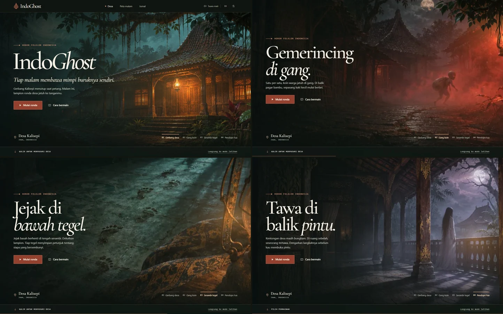

# Bukti pengujian migrasi IndoGhost

## Sebelum perubahan runtime

Salinan berkas asli dijalankan kembali di Chrome dengan profil uji. Pada 320×720, 375×812, 768×1024 dan 1440×900, pemeriksaan mencakup navigasi, fokus dialog, preferensi horor, kontrol suara, buka permainan, jeda, pindah bahasa dan reload. Semua permintaan aset berhasil dan tidak ada pengecualian halaman. Perjalanan sebelumnya dari save kosong berakhir dengan tujuh entri jurnal, 26 koin dan tiga petunjuk. Jumlah nyala dapat berbeda menurut cara pemain memakai lampion.

## Fondasi dan paritas aturan

Build fondasi pada Node 24.11.1 lulus pemeriksaan TypeScript strict dan Vite 7.3.8. Versi React/React DOM adalah 19.3.1, Phaser 3.90.0, GSAP 3.15.1, Lenis 1.3.27, Three.js 0.182.0 dan React Three Fiber 9.8.2. Versi lengkap tersedia di lockfile.

Modul aturan hasil migrasi dibandingkan langsung dengan salinan fungsi asli. Angka di bawah berasal dari eksekusi pembanding dengan masukan yang sama pada kedua versi.

| Perbandingan | Cakupan dan hasil |
| --- | --- |
| Tata desa Chase | Seluruh 14 kombinasi nomor malam dan kepemilikan petunjuk cocok untuk tembok, bangunan, spawn, gerbang, koin, titik patroli dan jalur pintas. |
| Deduksi Sweeper | Ketiga tata lantai, hitungan tetangga dan 1.500 kombinasi pembukaan, tanda kurungan dan kesalahan menghasilkan rekomendasi yang sama, termasuk sumber serta alasan langkah. |
| Patroli Escape | Penelusuran seluruh 2.480 keadaan aktif yang terjangkau memberi ramalan yang sama. Seluruh 11.452 transisi legal cocok, termasuk kunci, bunyi, tabrakan, kemenangan dan kekalahan. |

Pengujian fungsi ini melindungi aturan permainan. Pengujian browser memeriksa tambahan risiko yang muncul dari keyboard, sentuhan, waktu engine, renderer dan penyimpanan.

## Kampanye, penyimpanan dan audio

Perjalanan otomatis dimulai dari profil kosong. Playwright menggerakkan penjaga dengan keyboard sampai gerbang terbuka, memilih tegel melalui tombol permainan dan memainkan patroli kuntilanak sampai kentongan diperoleh. Setelah malam ketujuh, epilog terbuka. Muat ulang dan jurnal menampilkan **7/7 malam, 26 koin dan tiga petunjuk**. Dalam pengujian terpisah, mode latihan serta percobaan yang diulang tidak menambah catatan malam.

- Chrome berhasil mengekspor jurnal melalui alamat berkas versi lama lalu mengimpornya lewat dialog konfirmasi di versi HTTP. Dua malam dan kunci kuningan tetap terbaca setelah reload. Jurnal setempat yang lebih maju serta preferensi setempat mendapat prioritas. Input rusak dan penyimpanan yang ditolak juga diuji.
- Pengujian memantau oscillator yang benar-benar dimainkan Web Audio. Gerakan ancaman di Sweeper mengubah musik, jeda menghentikan penjadwalan nada dan mode tenang melewati sting. Ketiga pilihan intensitas, tombol lewati, retry, preferensi gerak dan pemulihan fokus diuji.
- Pada viewport sentuh 375×812, D-pad Chase menggerakkan pemain, satu koin dapat diambil dan penggunaan lampion mengurangi muatan. Jeda selama 4,2 detik mempertahankan perlindungan empat detik dalam waktu permainan. Masuk kembali menghasilkan satu canvas aktif.

## Cerita, aksesibilitas dan performa

Empat adegan diuji maju dan mundur. Tangkapan layar diambil dari build produksi melalui Chrome dengan bahasa Indonesia. Dari kiri atas searah urutan baca terlihat gerbang desa, gang koin, serambi tegel dan pendopo.

Setelah browser menggambar lewat WebGL2, pengujian benar-benar memutus konteks melalui `WEBGL_lose_context`. Poster mengambil alih, canvas 3D dilepas dan pemain berhasil mengambil koin di Chase. Saat unduhan modul 3D diputus, pemain masih bisa membuka tegel Sweeper. Dengan WebGL sepenuhnya dinonaktifkan, pemain tetap bisa berpindah ruangan di Escape. Klik bermain sebelum inisialisasi grafis menunda permintaan modul 3D.

Pengujian Chrome mencakup lebar 320, 375, 768 dan 1440 piksel serta layar lanskap 812×375 dan 844×390. Navigasi, fokus kembali, skip, kontrol dialog dan pilihan permainan diperiksa. Axe menjalankan aturan WCAG 2 A/AA serta 2.1 AA pada sampel landing dan panduan. Tidak ditemukan pelanggaran pada sampel tersebut.

| Profil pemuatan | LCP | CLS | Renderer |
| --- | ---: | ---: | --- |
| Desktop 1440×900 | 1,10 detik | 0,000 | WebGL2 melalui ANGLE/SwiftShader |
| Ponsel emulasi 375×812, gerak terbatas | 0,94 detik | 0,003 | Poster |

Angka ini berasal dari satu pemuatan per profil browser baru di Chrome 157.0.8103.79 pada Windows, lewat `vite preview` di loopback tanpa pembatasan CPU atau jaringan. Nilai diambil dari PerformanceObserver sebelum interaksi pertama. Angka tersebut merupakan pengukuran lokal. Performa pada ponsel fisik serta jaringan seluler memerlukan pengukuran tersendiri.

## Hasil build dan uji silang

| Pemeriksaan akhir | Hasil |
| --- | --- |
| Instalasi bersih | Salinan proyek tanpa `node_modules` berhasil menjalankan `npm ci` dan membangun ulang. Hash SHA-256 untuk seluruh 23 berkas distribusi identik dengan build yang diuji. |
| TypeScript strict dan Vite | Build produksi berhasil dari 89 modul. Entri JS 140,34 kB gzip, CSS awal 7,75 kB gzip. |
| Modul yang dimuat terpisah | Renderer Three.js/R3F 246,83 kB gzip. Mode Chase beserta Phaser 340,64 kB gzip. Vite memperingatkan ukuran keduanya melewati 500 kB sebelum gzip. |
| Vitest | Seluruh 20 pengujian unit lulus pada tiga berkas. |
| Playwright dan Chrome | Seluruh 19 skenario lulus dalam 1,2 menit melalui preview produksi. Cakupan meliputi kampanye lengkap, impor, audio, sentuh, fokus, ukuran layar dan pemulihan renderer. |
| Firefox 159.0 dan WebKit 27.2 | Pada masing-masing browser, cerita WebGL bergerak 0 → 3 → 0. Save v1 malam pertama berlanjut ke Sweeper. Setelah memakai nyala, menjeda, menyelesaikan malam kedua dan memuat ulang, jurnal menampilkan 2/7 dan kunci kuningan. Saat WebGL ditiadakan, Escape masih bisa dimainkan. |

Uji silang memakai browser Playwright headless di Windows pada 1024×768 dengan locale Indonesia. Validasi Safari di iOS, performa GPU perangkat fisik, pembaca layar dengan pengguna dan playtest manusia belum tercakup.

Untuk mengulang suite dari folder proyek, jalankan `npm ci`, `npm test`, `npm run build`, `npx playwright install chromium`, lalu `npm run test:e2e`. Runner menggunakan profil browser uji dan origin tersendiri agar jurnal pemain terlindungi.
